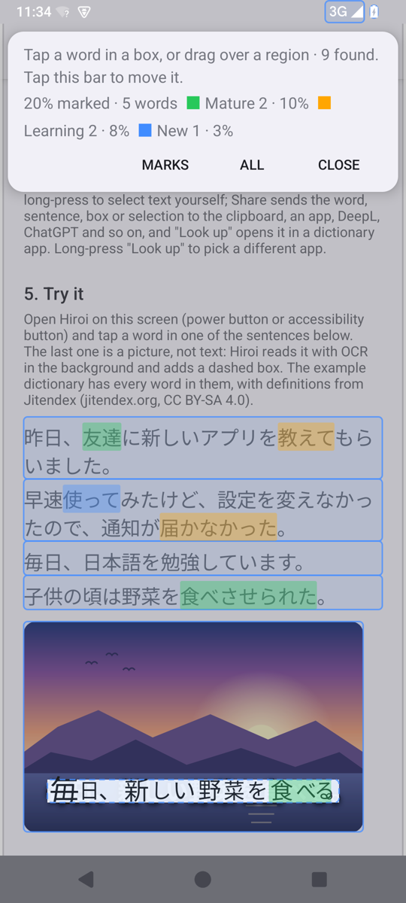
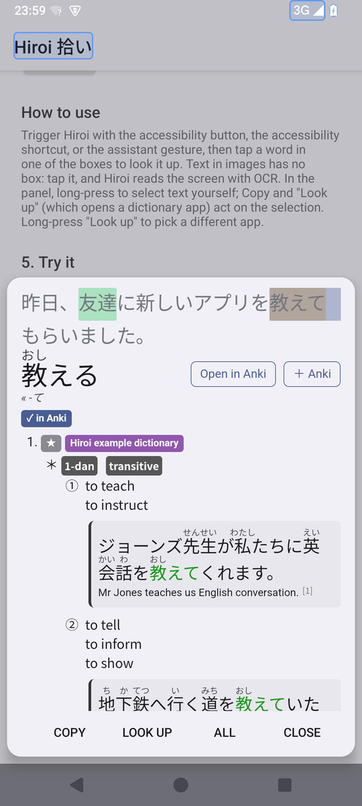
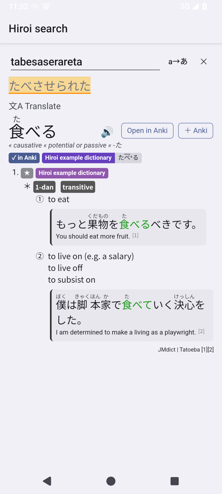

# Hiroi 拾い

A small Android app that picks up the text on your screen, even in apps that don't let you select it, so you can copy it or send it to a dictionary app such as PopLingo or Takoboto.

It reads text through an **accessibility service**, which sees every window, including the status bar, notifications and dialogs. It draws a box over each piece of text that contains Japanese. Tap a word in a box to look it up in your own **Yomitan dictionaries**, the same zip files desktop Yomitan uses. If the app doesn't report where its characters are (some WebViews, games, custom views), the tap opens the box's text in a panel, and you tap the word there. Conjugated forms are found too: 食べさせられなかった → 食べる. You can also select text to copy it or send it to another dictionary app.

| The overlay | A lookup | Search |
|---|---|---|
|  |  |  |

The screenshots are from the emulator (`scripts/emulator.sh`), on Hiroi's example sentences with the example dictionary and a small Anki deck:
- **The overlay:** every piece of Japanese text gets a box. Words you have in Anki are marked in their rule's colour (mature, learning, new), and the bar shows how much of the screen's text that is. The sentence in the picture at the bottom is read with OCR (the dashed box).
- **A lookup:** tapping 教えて shows 教える with its inflection, Anki status and the dictionary's definitions.
- **Search:** typing `tabesaserareta` searches たべさせられた and finds 食べる.

## Ways to open it

| Trigger | How |
|---|---|
| **Long-press the power button** | Make Hiroi the *digital assistant app*, then set the power button to open the voice assistant. On many phones this is under Settings → Additional settings → Power button. Gesture navigation can also open the assistant by swiping up from a bottom corner. |
| **Accessibility button / shortcut** | Once the service is on, Android shows the accessibility button: a floating button with gesture navigation, a nav-bar icon with buttons. You can also set the shortcut to *hold both volume keys*. |

With the keyboard open, Hiroi hides it before it reads the screen. Opening the overlay would close the keyboard anyway, and the app below would then move its text to where the keyboard was, away from the boxes. So Hiroi reads the screen once the app has moved its text, and opens the keyboard again on the same field when the overlay closes.

When the accessibility service is off, the assistant trigger still works. It then uses the view tree the system gives assistant apps, which covers only the foreground app and has less accurate positions.

## Setup on the phone

1. Install the APK.
2. Open Hiroi → *Accessibility settings* → turn on **Hiroi screen text**.
   On Android 13+ a sideloaded app's switch is greyed out at first. Open *App info*, tap ⋮ and choose **Allow restricted settings**, then try again.
3. Optional: *Digital assistant settings* → choose Hiroi, and enable *Use text from screen*.
4. Optional: import a Yomitan dictionary zip under *Dictionaries*.
5. Trigger it on any screen and tap a box. Then:
   - tap a word to look it up in your dictionaries. The matched word gets selected, so **Copy** copies it;
   - or long-press to select text yourself, then pick a dictionary app in the selection menu, or tap **Look up**. The first time, you pick the app and Hiroi remembers it. Long-press **Look up** to change it.

## Example

The bottom of the app's setup screen has Japanese example sentences to try Hiroi on, and a button that imports a small example dictionary with every word in them (`app/src/main/assets/example-dictionary.zip`). Its definitions are entries from [Jitendex](https://jitendex.org) (CC BY-SA 4.0, by Stephen Kraus, based on JMdict by the Electronic Dictionaries Research Group and Tatoeba example sentences). `scripts/make-example-dictionary.py <jitendex-yomitan.zip>` rebuilds it. The last example is a picture: a sentence in front of a photo-like sunset, as people post them, to try OCR on.

## Dictionaries

Import Yomitan dictionary zips under *Dictionaries* in the app, or open a downloaded zip with Hiroi (*Open with* / *Share*): term dictionaries (Jitendex, JMdict), frequency lists (JPDB), pitch accent (Kanjium) and kanji dictionaries (KANJIDIC). They're stored in SQLite on the phone. So are the images some dictionaries come with: pictures, diagrams or stroke orders that definitions show. Results show them as Yomitan does, at the size the dictionary asks for (in px, or em with `sizeUnits`), keeping their aspect ratio, pixelated where the dictionary says so, collapsed until tapped where it wants that, with their description. Anki cards get them too (see [Templates](#templates)).

The order of the dictionaries is their priority, as in Yomitan: results show the definitions, frequencies and pitch accents of dictionaries higher up first. Anki cards see this order too, and so does the default sort list. New dictionaries go to the end; **▲▼** in the list move them. The checkbox in front of each turns it off or on, as Yomitan's switch per dictionary does: one that's off stays installed but is left out of lookups, frequency sorting, Anki's per-dictionary markers and the dictionary info Anki templates get. Collections export every dictionary, on or off, since Yomitan's format has no such flag.

**Collections**: *Export collection* writes all dictionaries into one file, in their order, and *Import collection* reads one, as Yomitan's *Backup → Export / Import dictionary collection* do. The files are Yomitan's own format, Dexie's export of its dictionary database (version 60, with Yomitan's tables and indexes), so they work both ways:
- **into Hiroi:** a collection exported from Yomitan, instead of every dictionary zip again;
- **out of Hiroi:** one into Yomitan, or onto another phone.

Unlike Yomitan's import, which replaces everything, Hiroi's adds the dictionaries that aren't there yet, after the others, and leaves those already imported (by title) as they are. Both read and write as a stream, so collections of hundreds of MB are fine. Dictionary images go along, in Yomitan's media table. Opening a collection file with Hiroi (*Open with*) imports it too.

Results look like Yomitan's popup:
- the headword with furigana, then tags for the inflection, Anki status, frequencies and pitch accent,
- the definitions, numbered and labelled with their dictionary, styled by the dictionary's own `styles.css` as in Yomitan (Jitendex's coloured labels and example-sentence boxes, for instance), with the dictionary's images.

The looked-up word is also marked in the box on screen, where the app reports its character positions. Dictionaries imported before styles and images were supported need importing again to get them.

A lookup works like Yomitan's: starting at the tapped character, it tries the longest text first, both as written and deinflected. A deinflected form only matches entries whose part-of-speech rules fit (`v1`, `v5*`, `vk`, `vs`, `adj-i`). The deinflection rules are [Yomitan](https://github.com/yomidevs/yomitan)'s own (`japanese-transforms.js`). `scripts/update-yomitan-transforms.mjs` exports them to `app/src/main/resources/.../japanese-transforms.json`, and `LanguageTransformer.kt` is a Kotlin port of Yomitan's engine. The script also records Yomitan's results for sample words, and `YomitanParityTest` checks the port returns exactly the same. One addition: する verb forms also match the noun (勉強した → 勉強), since dictionaries list those verbs under the noun.

To move to a newer Yomitan release:

```bash
node scripts/update-yomitan-transforms.mjs 26.11.2.0
```

### Frequency lists

Frequency lists (JPDB, BCCWJ, Innocent Corpus, …) show as a tag per list, with all of a list's values for the reading (`JPDB 1234, 5678㋕`), on words and, from `kanji_meta_bank` files, on kanji. With **Average frequencies** on, they're compressed into one *Average* tag, the harmonic mean of each list's lowest value, as Yomitan's option of that name does. Lists of occurrence counts are left out of the mean.

**Result sorting** works like Yomitan's: results are sorted by how much of the text they match, then whether they needed the text read as hiragana, then the number of conjugation steps, then whether the headword is spelled as matched. After that comes the chosen frequency list, then dictionary order, then the entries' scores. A frequency list sorts in one of two ways:
- lower values first, for ranks;
- higher values first, for occurrence counts.

Choosing a list picks the way from its `index.json` (`frequencyMode`: `rank-based` or `occurrence-based`). For lists that don't say, Hiroi compares their values for common and rare words, with the same words Yomitan uses. Words without a value in the list come after those with one. Until you choose one, Hiroi sorts by the first frequency list you imported; choose *none* to sort without one.

Tag banks are only used for Anki cards so far; the results show tags by their name.

## Search

*Search dictionaries* on the main screen (or long-press Hiroi's launcher icon → *Search*) opens a search page like Yomitan's. Type or paste Japanese and the results come up as you type. Romaji is searched as kana, as in Yomitan's search box: `taberu` → たべる, upper case for katakana (`TEREBI` → テレビ), `nn`/`n'` for ん, `-` for ー; the **a→あ** button switches that off. The results are for the text from its first character, so a sentence gives its first word and a conjugated form its dictionary form (食べさせられた → 食べる). The text is shown below the search box too, with the matched word highlighted and the words you have in Anki marked; tap any character in it to look up the word starting there. Results look and work as in the overlay, with ＋ Anki and Open in Anki (the card's sentence is the searched text).

Other apps can send text there: select it and choose **Hiroi search** in the selection menu (Android's `PROCESS_TEXT`, like the dictionary apps Hiroi's own *Look up* offers).

## Audio

Each result has a 🔊 button that plays the word, as in Yomitan. It tries the **audio sources** in their order and plays the first recording one has (*Dictionaries → Audio → Sources*):

| Source | |
|---|---|
| JapanesePod101 | The default, as in Yomitan. Its "no audio for this word" recording is recognised (by its SHA-256, as Yomitan does) and skipped. |
| Jisho | The recording on jisho.org's page for the word. |
| Custom URL | A URL with `{term}`, `{reading}` and `{language}` (`ja`) filled in, whose answer is the audio. |
| Custom URL (JSON) | A URL answering with Yomitan's audio list, `{"type": "audioSourceList", "audioSources": [{"url": …, "name": …}]}`, e.g. a local audio server made for Yomitan. |
| Text-to-speech | The phone's Japanese voice, for the word or for its reading. |

Long-press 🔊 for Yomitan's audio menu: every source and recording, marked *(none)* where a source has nothing, to play one. The one picked is also what the result's Anki card gets for `{audio}`; without a pick, `{audio}` takes the first recording the sources have. Text-to-speech can't go on a card, so it's skipped there.

The other options are Yomitan's too:
- auto-play the first result's audio when results show;
- volume;
- a fallback sound when no source has audio (none, a click or a bloop, Yomitan's sounds);
- turning the button off.

Recordings are downloaded once per lookup and played on the phone; nothing else is sent anywhere. Lingua Libre, Wiktionary and the generic LanguagePod101 sources aren't there: they're for other languages and have little Japanese.

## OCR

Apps don't expose text inside images; at most they describe the picture (Instagram: 写真、…), which doesn't stop Hiroi from reading the text in it. So as soon as the overlay opens, Hiroi reads the screenshot it took on trigger with Google ML Kit's on-device Japanese recognizer, in the background. Japanese lines it finds in images are added as dashed boxes when it's done, usually within a second, with the recognized text drawn over the picture where it was found. The other boxes can be used meanwhile. If you tap an image before then, the word under your tap is looked up once its line arrives. Everything runs on the phone; the model is bundled, so it needs neither a network connection nor Play Services.

- Screenshots need the accessibility service. With only the assistant trigger, Hiroi uses the screenshot Android hands to assistants, if *Use screenshot* is on in the assistant settings.
- Apps that forbid screenshots (streaming, banking) give a black image, so there's nothing to read.
- ML Kit reads horizontal text well; vertical text (manga) is hit and miss.
- The first scan after starting the app takes a moment while the model loads.

**Licensing:** ML Kit is closed source (Google APIs Terms of Service), while Hiroi is GPL-3.0 and contains Yomitan's GPL code. Publishing this source code is fine, and so is building the app for yourself. Distributing built APKs, which bundle ML Kit, would conflict with the GPL. A distributable build would need an open-source OCR engine (PaddleOCR, Tesseract), or ML Kit in a separate companion app.

## Anki

Under *Anki* in the app, pick a deck and the field that holds the word. Lookups then show **✓ in Anki** or **not in Anki** for each headword. A field matches if its text is the word, ignoring HTML and furigana such as `使う[つかう]`.

Hiroi talks to [AnkiConnect](https://foosoft.net/projects/anki-connect/):
- **On the phone:** AnkiDroid plus [AnkiConnect Android](https://github.com/KamWithK/AnkiconnectAndroid), with its service started. It listens on `http://127.0.0.1:8765`, Hiroi's default.
- **Desktop Anki** with the AnkiConnect add-on: enter its address, e.g. `http://192.168.0.20:8765`. On that machine, set `"webBindAddress": "0.0.0.0"` in AnkiConnect's config. Also set an `apiKey` and enter it in Hiroi, because anyone on the network can then reach your Anki.

### Making cards

With a card format set up under *Anki → Cards*, every result in the overlay and on the search page gets a **＋ Anki** button that adds a note, the way Yomitan's button does. A card format works like Yomitan's: a deck, a note type, and a value per field with markers such as `{expression}` or `{glossary}`. *Fields…* edits them, and its **{…}** menu lists the markers: Yomitan's standard ones, one pair per dictionary (`{single-glossary-jitendex}`, `{single-frequency-number-jpdb}`), and those your own templates add. **Import from Yomitan settings…** takes a format from a Yomitan settings export (*Yomitan → Settings → Backup → Export settings*), together with that profile's Anki card templates and its compact glossary and tag settings; with several profiles, you pick one. Otherwise, choose a note type and Hiroi suggests field values from the field names.

#### Templates

Fields are filled by **Yomitan's own code**: its `AnkiNoteBuilder`, its Handlebars template renderer with all its helpers (`furigana`, `regexReplace`, `formatGlossary`, `pronunciation`, `set`/`get`, …), and its default Anki card templates. Each `{marker}` is the template of that name (`{{#*inline "expression"}}…{{/inline}}`), so fields come out exactly as Yomitan fills them, and so does anything built on them: JP Mining Note's `{jpmn-*}` markers, the pitch graphs, `{phonetic-transcriptions}`, Lapis's fields, or markers of your own.

*Anki card templates…* is Yomitan's templates page:
- the template text, saved as you leave the page, and **Reset to Yomitan's default**;
- a **test**: a text to look up and a field value with markers, filled for the first word in the text, with the templates' errors;
- **Compact glossaries** (Yomitan's *Compact Popup and Anki* layout) and **Compact tags**.

A marker the templates don't define comes out as `{marker-render-error}`, as in Yomitan. *Cards* lists such markers, and adding a card says which templates failed.

Hiroi gives the templates what Yomitan's translator would: the dictionary entry with its headword, inflections, definitions (the dictionaries' structured content as is), tags from the dictionaries' tag banks, frequencies and pitch accents, and the note context (sentence, document title: the app the text came from). Dictionaries imported before tag banks were supported need importing again to get their tag categories and notes. Media go through the same two passes as in Yomitan: the first rendering tells which ones the fields need, then Hiroi provides them and the fields are rendered again:
- `{audio}`: word audio from JapanesePod101, Yomitan's default source;
- `{screenshot}`: the screen when the overlay opened;
- `{clipboard-text}`: the clipboard;
- `{popup-selection-text}`: the panel's selection;
- `{sentence-furigana}`: the sentence parsed with Hiroi's own lookup, word by word, so it's only as good as your dictionaries.

`{clipboard-image}` stays empty. Images in a glossary are stored in Anki, as Yomitan stores them, so `{glossary}` shows them on the card.

The templates run in a WebView of their own, without network or file access. `scripts/update-yomitan-anki.mjs` bundles Yomitan's code for it (`app/src/main/assets/yomitan/`) from a Yomitan release:

```bash
podman run --rm -v "$PWD":/work:Z -w /work docker.io/library/node:24-slim node scripts/update-yomitan-anki.mjs 26.11.2.0
```

**Duplicates** are detected as in Yomitan. A duplicate is a note with the same first field. When the results show, Hiroi asks Anki which of them would be duplicates, with `canAddNotes` for all at once and then `findNotes` for the duplicates. Their **＋ Anki** button then says what tapping it would do, depending on *Cards → If there is one*:

- **add another note**, Yomitan's default: the button reads *＋ Anki again*.
- **don't add a note**: the button reads *Already in Anki* and is disabled.
- **overwrite the existing note**: the button reads *Overwrite*. Each field is updated by its overwrite mode, chosen under *Field templates…*, with Yomitan's modes:
  - *Fill if empty* (the default): the new value only where the field is empty;
  - *Overwrite if available*: the new value unless it's empty;
  - *Overwrite*: always the new value;
  - *Append*, *Prepend*;
  - *Skip*: keep the old value.

  Fields that would stay the same aren't sent.

Either way, *Open in Anki* opens the existing notes, with their number when there are several. *Look in* sets where to search for duplicates: the whole collection, the card format's deck, or its top deck with all subdecks. *Count notes of every note type* also counts notes of other note types. All of these are imported from Yomitan settings too, including each field's overwrite mode.

Words that already have a note (with the Anki check set up), and words you just added, get an **Open in Anki** button. On the phone it opens AnkiDroid's card browser on those notes. Switch that browser to *All decks* once, because AnkiDroid's link only searches the deck it last showed. With desktop Anki, AnkiConnect's `guiBrowse` opens the browser on the computer.

Hiroi uses only actions AnkiConnect Android supports: `deckNames`, `modelNames`, `modelFieldNames`, `findNotes`, `notesInfo`, `canAddNotes`, `addNote`, `updateNoteFields`, `storeMediaFile` and, for desktop Anki, `guiBrowse` and `notesModTime`. Requests go to Anki one at a time.

### Marking the words you have

Like [AnkiMark](https://github.com/kvth/ankimark) does on web pages, Hiroi can mark the words you have notes for in Anki, in the boxes over the app and in the panel. *Anki → Marks…* has the same settings as AnkiMark:

- **Rules**: each an Anki search plus a colour. A word gets the colour of the first enabled rule (top to bottom) that one of its notes matches. The defaults: Leech `prop:lapses>=8` (off), Mature `prop:ivl>=21`, Learning `-is:new`, New `is:new`. Add, reorder, recolour and switch rules off, add one of the examples (`is:due`, `rated:7:1`, `prop:r<0.8`, …), and **Check searches** shows each rule's number of notes or what's wrong with its search.
- **Base filter**, put in front of every rule: usually your deck (*Use a deck…*). Until you set one, it's the deck chosen for lookups.
- **Fields** holding the word (none: each note's first field), and a **field script**: JavaScript that gets the note and returns more words, e.g. the other spellings Yomitan's dictionaries list as "forms" in the Glossary field (the example). It runs in a WebView of its own without network access; **Test** shows the words of a few notes.
- **Display**: background (with its strength) or underline; conjugated forms (食べなかった → 食べる, with Yomitan's deinflection rules, as for lookups); kana words in either script (ゴミ ↔ ごみ); the shortest kana-only words to mark.
- **On / off**: everywhere, or off for single apps. In the overlay, **Marks** (next to *All* while the hint shows) has both switches, for the app the text came from, and *Sync now*.
- **Syncing**: when the overlay opens and the last sync is older than 1, 5, 15 or 60 minutes, or only on *Sync now*. Meanwhile the overlay uses the last sync's words. A sync reads only notes that are new or edited since the last one (`notesModTime`; AnkiConnect Android lacks it, so there only new notes, plus everything once a day). The rule searches run every time, since cards change state with every review.
- **Backup**: export and import the settings as JSON. The files are compatible with AnkiMark's in both directions; the sites AnkiMark is off for and the apps Hiroi is off for stay with each.

Matching works as in AnkiMark: fields are cleaned of HTML, furigana, cloze markers and `(する)`-style parts, lists like `食べる、喰べる` are split, and the longest known word at each position wins. While the hint shows, the panel shows how much of the screen's Japanese text is marked, in characters, and how many different words that is, per rule. Boxes whose app doesn't report character positions are only marked in the panel.

## Limitations

- Text an app doesn't expose to accessibility (pictures, games, video subtitles) is only found by OCR, which reads horizontal text well but vertical text (manga) only sometimes, and nothing in apps that forbid screenshots.
- As the assistant app, Hiroi replaces Google Assistant / Gemini on the long-press gesture. Its stub speech recogniser always fails, so apps that use the *system default* speech recogniser lose voice input. Keyboards with their own voice input are not affected.

## Build

The build runs in podman, so the Android SDK never touches the host (see `Containerfile.android`). It runs the unit tests and then builds the APK. The first run downloads the SDK; later runs reuse the cached layers.

```bash
./podman-build-apk.sh            # -> build/outputs/hiroi-debug.apk
./podman-build-apk.sh --install  # also adb install -r (needs adb on the host)
```

## Emulator

`scripts/emulator.sh` runs Hiroi in an Android 15 emulator inside podman (needs `/dev/kvm`), set up like a phone in use: Japanese system language, the accessibility service on, Hiroi as the digital assistant, and a dictionary imported. The default dictionary is the app's example dictionary; you can pass your own zip instead.

```bash
scripts/emulator.sh start                 # or: scripts/emulator.sh start ~/Downloads/jitendex-yomitan.zip
scripts/emulator.sh view                  # a window showing the emulator; click and type in it yourself
scripts/emulator.sh app                   # Hiroi's example sentences
scripts/emulator.sh settings              # the Settings app, which has Japanese text
scripts/emulator.sh texts                 # text on screen and where to tap it; Hiroi's boxes sit there
scripts/emulator.sh trigger               # open the overlay, as long-pressing power does
scripts/emulator.sh tap 521 1398          # tap a box, then a word in the panel
scripts/emulator.sh screenshot            # -> build/emulator/screenshot.png
scripts/emulator.sh anki                  # AnkiDroid + AnkiConnect Android with the Lapis note type
scripts/emulator.sh yomitan ~/Downloads/yomitan-settings.json   # take a card format from Yomitan settings
scripts/emulator.sh fake-anki             # or: a fake AnkiConnect deck (Japanese::Core, field Word, cards in every state), much quicker
scripts/emulator.sh logcat                # Hiroi's log and crashes
```

After a code change: `./podman-build-apk.sh && scripts/emulator.sh install`. Run `scripts/emulator.sh` without arguments for all commands.

## License

Copyright (C) 2026 Kevin Thomas

GPL-3.0-or-later, see [LICENSE](LICENSE). The deinflection rules and `LanguageTransformer.kt` come from [Yomitan](https://github.com/yomidevs/yomitan) (GPL-3.0-or-later, Copyright (C) 2024-2026 Yomitan Authors), and so does the Anki note building bundled in `app/src/main/assets/yomitan/` (GPL-3.0-or-later, Copyright (C) 2023-2026 Yomitan Authors, 2020-2022 Yomichan Authors), with its libraries [yomitan-handlebars](https://github.com/yomidevs/yomitan-handlebars) and [Handlebars](https://handlebarsjs.com) (MIT) and [linkedom](https://github.com/WebReflection/linkedom) (ISC). The fallback sounds in `app/src/main/assets/audio/` come from Yomitan; `fallback-bloop.mp3` is by [UNIVERSFIELD](https://pixabay.com/sound-effects/error-8-206492/) under the [Pixabay Content License](https://pixabay.com/service/license-summary/). The launcher icon is 拾 from [Noto Sans CJK JP](https://github.com/notofonts/noto-cjk) (SIL Open Font License), turned into a vector by `scripts/make-icon.py`.
